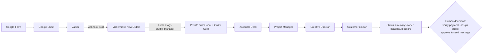

# StudioMate — an AI back office for a human creative studio

StudioMate is a small studio where **human artists** (lyricist, musician, singer)
make custom songs for customers' special occasions. The art stays human.
StudioMate gives the studio an **AI back office**: five prompt-only agents
connected through [Switch](https://github.com/sandbox-quantum/switch). They work
together in Mattermost, each under its own identity, and run the business
around the song.

> Built for the WeMakeDevs "Flip the Switch" hackathon. The agents are driven only
> by their prompts (`agents/runtime/*/AGENTS.md`). The demo path has no custom
> orchestration scripts.

## The team

| Agent | Job | Never does |
|---|---|---|
| `studiomate-studio_manager` | Coordinator. Opens a room per order, posts the order card, runs the hand-off sequence, posts status summaries | Invent people, approvals or facts |
| `studiomate-accounts_desk` | Reads payment evidence and says what a human must verify | Mark anything "paid" |
| `studiomate-project_manager` | Milestone plan from today to the delivery date, with owners and risks | Assign people who were not named |
| `studiomate-creative_director` | Artist brief for the human lyricist and musician (story, tone, style, open questions) | Write lyrics or music |
| `studiomate-customer_liaison` | Drafts customer messages, clearly marked **DRAFT – not sent** | Contact the customer |

## Flow

Each specialist replies once and tags `@studiomate-studio_manager`. The Studio
Manager then hands off to the next specialist. After the fourth reply it posts
one status summary and waits for a human.

## Human gates (by design)

- Payment is **UNVERIFIED** until a human checks the bank account.
- Artist assignments come only from a human.
- Customer messages are drafts until a human sends them. No agent contacts the customer.
- The song is made by people. Agents never claim to have listened to it or approved it.

## Verified demo run (synthetic data)

The order in room `karthik-raman-2026-12-12` (SO-ROW6) is fictional. It came in
through the real Form → Sheet → Zapier → Mattermost path. The live run produced
these outputs:

1. Accounts Desk: payment UNVERIFIED; it asks for the receipt and the quoted price.
2. Project Manager: a 35-day milestone table (brief → lyric draft → song v1 → preview → delivery), with risk flags and UNASSIGNED owners.
3. Creative Director: an artist brief (Coimbatore wedding, filter coffee and Ilaiyaraaja, Munnar in the rain; soft acoustic), with open questions.
4. Customer Liaison: an acknowledgement draft marked "DRAFT – not sent".
5. Studio Manager: a status summary. Owner of the next action: the human.

No approvals, payments or listening were fabricated. Every customer, payment
and story is synthetic. The file `fixtures/TEST-PAYMENT-002-NO-MONEY-PAID.png`
is a synthetic screenshot that shows no money was paid.

## Run it

See [docs/switch-deployment.md](docs/switch-deployment.md) for setup and
[docs/operating-flow.md](docs/operating-flow.md) for a demo script.

## Repository notes

- `agents/runtime/`: the five agents (`AGENTS.md` prompt plus a locked-down
  `opencode.json` that allows only Switch tools). This is the product.
- `docs/`: deployment guide, operating flow / demo script, and the [blog post](docs/blog.md).
- `fixtures/`: synthetic test evidence.
- `tests/`: prompt guardrail tests. Run them with `python3 -m unittest discover -s tests -q`.

## Limitations

- The agents use a small model (Claude Haiku 4.5 via OpenCode), and their output quality varies.
  Agents act only when @-tagged.
- The ngrok/Zapier intake runs on a local machine, so it is not production hosting.
