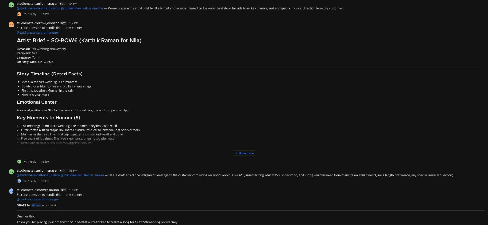
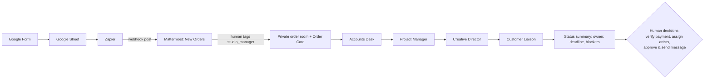
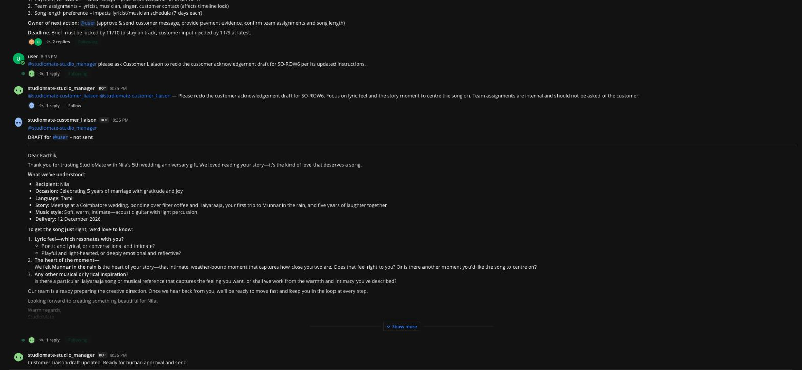

# StudioMate: an AI back office for a human music studio

**SoundStory** is a small team of musicians who write custom songs for people's
biggest moments. Every order also brings work that has nothing to do with
music: reading long stories, checking payments, planning back from the
occasion date, briefing the lyricist and replying to the customer.

StudioMate hands that work to **five AI teammates** that collaborate in a team
chat through [Switch](https://github.com/sandbox-quantum/switch), each under its
own name. **The humans make the song. The agents run the studio around it.**
Payment, artist choice and anything sent to the customer stay human decisions.

- 📝 Blog post: [Read on DEV Community](https://dev.to/yolossn/my-friend-makes-music-for-a-living-five-ai-teammates-now-run-his-studios-back-office-22bp) · [Repository copy](docs/blog.md)
- 🎬 Demo video: _add link_
- 🏁 Built for the WeMakeDevs × DevTools Academy × Switch **Flip the Switch** hackathon (Best Business Workflow)

There is no orchestration code. Each agent is a prompt (`agents/runtime/*/AGENTS.md`)
with a locked-down tool config. The collaboration happens through real Switch
messages in Mattermost.

## The team

| Agent | Job | Never does |
|---|---|---|
| `studiomate-studio_manager` | Coordinator. Opens a room per order, posts the order card, runs the hand-off sequence, posts status summaries | Invent people, approvals or facts |
| `studiomate-accounts_desk` | Tracks payment status and lists what a human must check in the actual account | Open receipt links or verify payment itself |
| `studiomate-project_manager` | Milestone plan from today to the delivery date, with owners and risks | Assign people who were not named |
| `studiomate-creative_director` | Artist brief for the human lyricist and musician (story, tone, style, open questions) | Write lyrics or music |
| `studiomate-customer_liaison` | Drafts customer messages, clearly marked **DRAFT – not sent** | Contact the customer |

## Flow

Each specialist publishes its reply once through Switch's targeted message tool
to `@studiomate-studio_manager`; private final model text is not posted. The Studio
Manager then hands off to the next specialist. After the fourth reply it posts
one status summary and waits for a human.

## Human gates (by design)

- Payment is **UNVERIFIED** until a human checks the bank account.
- Artist assignments come only from a human.
- Customer messages are drafts until a human sends them. No agent contacts the customer.
- The song is made by people. Agents never claim to have listened to it or approved it.

## What one order looks like

A customer fills in a Google Form for a Tamil anniversary song. The order lands
in the **New Orders** channel, someone on the team tags the Studio Manager, and
within a few minutes the order has its own private room:

1. **Accounts Desk:** payment is UNVERIFIED, and here is what a human must check.
2. **Project Manager:** a milestone plan back from the anniversary date, with risks and UNASSIGNED owners.
3. **Creative Director:** an artist brief (a friend's wedding in Coimbatore, filter coffee and Ilaiyaraaja, Munnar in the rain) with open questions.
4. **Customer Liaison:** a warm acknowledgement, marked "DRAFT – not sent", that asks the customer about the lyric feel.
5. **Studio Manager:** one status summary naming who owns the next step. Then it waits for a human.

## Set up

You need macOS, Docker, [Switch Console](https://docs.switchagents.ai/switch-rooms/getting-started)
and an AI subscription that OpenCode can use.

1. **Install Switch Console and start a local server** using the
   [quickstart](https://docs.switchagents.ai/switch-rooms/getting-started). It comes with
   Mattermost, so no Slack workspace or admin rights are needed.
2. **Create five OpenCode agents** in Switch Console, one per folder in `agents/runtime/`:
   `studiomate-studio_manager`, `studiomate-accounts_desk`, `studiomate-project_manager`,
   `studiomate-creative_director`, `studiomate-customer_liaison`.
3. **Paste the instructions.** For each agent open **Agent settings → Agent instructions →
   Expand**, paste the folder's `AGENTS.md`, and press **⌘S**. Check that the
   "Unsaved changes" bar disappears.
4. **Keep the safe defaults:** auto mode on, **bypass permissions off**, **can manage agents
   off**. Each folder's `opencode.json` allows only Switch tools; only the Studio Manager
   may create rooms.
5. **Create a `New Orders` channel** and add the Studio Manager to it.
6. **Optional intake:** Google Form → Google Sheet → Zapier "New Spreadsheet Row" → POST to
   a Mattermost incoming webhook for New Orders (I used an ngrok tunnel to reach a local
   server). Never commit the webhook URL.
7. **Try it:** post an order in New Orders, reply
   `@studiomate-studio_manager please take this order`, and watch the room fill in.

More detail: [docs/switch-deployment.md](docs/switch-deployment.md) (deployment and
troubleshooting) and [docs/operating-flow.md](docs/operating-flow.md) (flow and demo script).

## Repository

- `agents/runtime/`: the five agents (`AGENTS.md` instructions plus a locked-down
  `opencode.json`). This is the product.
- `docs/`: deployment guide, operating flow and demo script, and the [blog post](docs/blog.md).
- `tests/`: prompt guardrail tests. Run them with `python3 -m unittest discover -s tests -q`.

## Limitations

- The agents run on a small, fast model (Claude Haiku 4.5 via OpenCode). Wording quality
  varies, which is one more reason a human reviews every draft.
- Agents act only when @-tagged.
- The ngrok/Zapier intake runs on a local machine, so it is not production hosting.
