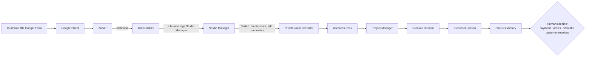

# My friend makes music for a living. Five AI teammates now run his studio's back office.

*How I used Switch to build an AI back office for SoundStory, a small team of musicians who write custom songs for people's biggest moments, so they could get back to making music.*

> Built for the WeMakeDevs × DevTools Academy × Switch **Flip the Switch** hackathon (Best Business Workflow).
> Stack: Switch Console + a local Switch server · Mattermost (bundled with Switch) · five OpenCode agents · Google Form → Sheet → Zapier for intake. No orchestration code.

---

## Part 1: The studio that was drowning in messages

My friend is a musician. With a few others (a lyricist, a composer, a singer or two) he runs **SoundStory**. People come to them with a story: *we met at a friend's wedding, we bonded over filter coffee and old Ilaiyaraaja songs, our first trip was to Munnar in the rain.* A few weeks later they get back a song about that story, made for an anniversary, a wedding, a birthday or a goodbye.

It's a beautiful business, and it is growing. That growth is the problem.

Every order is a stream of small jobs that have nothing to do with music:

- reading a long, emotional story and pulling out what matters;
- checking whether the payment screenshot is real and whether the money actually arrived;
- working backwards from the occasion date: when must the lyrics be ready, and when the first cut?
- briefing the lyricist so the song is about *this* couple and not every couple;
- replying to the customer warmly, quickly, and without promising something the team can't deliver;
- remembering, three weeks later, what was agreed and who is waiting on whom.

They are musicians. They want to spend their evenings at the keyboard, not in a dozen WhatsApp-style threads asking "did they pay?" and "when is it due again?". As more people reached out, the business around the music was becoming too much. Some days it was eating the music itself.

When I heard about the **Flip the Switch** hackathon, the brief was simple: *build a workflow where AI agents and people in a team chat get real work done together.* I already knew which team I wanted to build it for, and what to build:

> **The humans make the song. The agents run the studio around it.**

SoundStory doesn't need help writing songs. That's the part they're brilliant at and the part they love. They need help with *everything else*.

---

## Part 2: Hiring five AI teammates

Instead of one big "AI assistant", I gave the studio a small back office. Five agents each have one job, a name, a face in the chat, and a list of things they're **not allowed** to do.

| Teammate | Their job | What they are forbidden to do |
|---|---|---|
| **Studio Manager** | The coordinator. Opens a private room per order, posts the order card, hands work to one teammate at a time and posts the status summary | Invent people, approvals or facts |
| **Accounts Desk** | Reads payment evidence and says exactly what a human must check | Mark anything "paid" |
| **Project Manager** | Plans backwards from the occasion date: brief, lyrics, first cut, preview, delivery | Assign people nobody named |
| **Creative Director** | Turns the customer's story into a brief for the human lyricist and composer | Write lyrics or music |
| **Customer Liaison** | Drafts every message to the customer, labelled **DRAFT – not sent** | Contact the customer |

Each one is an OpenCode agent created in **Switch Console**, with its own identity in the chat. You can @-mention any of them like a colleague. None of them is a hidden step in a script. In fact there is **no script**: the whole workflow lives in five plain-English instruction files.

---

## Part 3: A day in the life of an order

Here's what happens now when a story arrives. Everything below is from a real run with a **synthetic** order: a fictional Karthik, ordering a Tamil song for his wife Nila's fifth anniversary.



**1. The story lands.** Karthik fills in a Google Form. Zapier picks up the new row and posts it into the `#new-orders` channel. No AI has touched it yet.

**2. A human says "go".** Someone from the team replies in the thread: *"@studiomate-studio_manager please take this order."* Agents never pick up work on their own.

**3. The order gets its own room.** The Studio Manager creates a private room called `karthik-raman-2026-12-12`, brings in the human and the four specialists, and replies in the thread: `Order room: ~karthik-raman-2026-12-12`. Then it posts the order card:

```text
## Order Card – SO-ROW6
Customer: TEST ONLY - Karthik Raman (fictional)
Recipient: Nila (fictional)
Occasion: TEST ONLY - 5th wedding anniversary
Language: Tamil
Delivery date: 12/12/2026
Payment status: UNVERIFIED — human review required
```

**4. The team works, one at a time, in the open.** The Studio Manager tags Accounts Desk. Accounts Desk answers and tags the manager back. Then Project Manager, then Creative Director, then Customer Liaison. Every message comes from a different teammate, in one room, where every human can see it.

The **Project Manager** planned backwards from the anniversary and refused to invent who would do the work:
```text
| Lyric draft ready | 11/14/2026 | +7d  | UNASSIGNED (Lyricist) | Brief confirmed |
| Song v1 complete  | 11/28/2026 | +21d | UNASSIGNED (Musician) | Lyric acceptance |
Risk: Lyricist and Musician each have ~7 days (tight for creative work)
```

The **Creative Director** wrote a brief that a lyricist would actually want to read:
```text
### Emotional Center
A song of gratitude to Nila for five years of shared laughter and companionship.
### Things to Avoid
- Generic love-song clichés
- Place/date errors (Coimbatore, Munnar, Ilaiyaraaja references must be accurate)
```

The **Customer Liaison** wrote the kind of message a good studio sends, and then didn't send it:
```text
DRAFT for @user – not sent

1. Lyric feel — poetic and lyrical, or conversational and intimate?
2. We felt Munnar in the rain is the heart of your story… Does that feel right to you?
   Or is there another moment you'd like the song to centre on?
```

**5. One summary, then quiet.** The Studio Manager posts a single status update (stage, owner of the next action, deadline, blockers) and stops until a human speaks:
```text
Owner of next action: @user (approve & send customer message,
provide payment evidence, confirm team assignments and song length)
```

Each specialist took between 9 and 18 seconds. Something that used to cost an evening of messages took **under two minutes**, and nobody on the team had to type it.


*Hand-offs in the order room: each teammate posts under its own identity and tags the Studio Manager back.*


*The customer draft asks about the song, not the org chart, and waits for a human to send it.*

---

## Part 4: The moment it clicked

When the flow was running end to end, I showed it to my friend and his team.

I expected polite interest. Instead they were **genuinely surprised**, first by the quality. The brief picked out exactly the details they would have circled themselves: the filter coffee, Ilaiyaraaja, Munnar in the rain. The customer draft didn't sound like a bot. It asked the questions they actually ask: *what feel do you want for the lyrics, and is this the moment the song should be about?*

Then by the restraint. The agents didn't pretend the payment was confirmed. They didn't pick a singer. They didn't message the customer. They did the tedious part well and handed the decisions back to the people who should make them.

What struck them most was what it meant for their week. They love doing what they do best, **making music**. Everything around running the business had quietly become too much. Seeing a back office that handles the reading, planning, chasing and drafting, while leaving every real decision with them, changed how they thought about what AI agents could do for a small creative business.

<!-- DRAFT QUOTE: written as a placeholder. Confirm the wording with him (or replace it with his real words) before publishing. -->
> *"Honestly, I thought it would just spit out some lyrics. But it read the story the way we read it: it caught Munnar, the filter coffee, Ilaiyaraaja. And it didn't decide anything for us. That's the part we've been drowning in. If this takes the messages off our plate, we can go back to making music."*

---

## Part 5: Why this only works because of Switch

The hackathon asks a pointed question: *is Switch central, and would the project stop working without it?* For SoundStory the answer is yes, and here is exactly why.

| What SoundStory's back office needs | What makes it possible | Without Switch |
|---|---|---|
| Five *separate* teammates with their own names, faces and instructions, posting as themselves in the team chat | Switch Console creates each OpenCode agent and gives it a chat identity | One shared bot account, or five terminal windows that can't see each other |
| A mention reaching exactly the right teammate, with the room's context | Switch routes @-mentions to the right agent with that room's conversation | A home-made router, webhook server and context store |
| The coordinator opening a private room per order and inviting the right teammates | Switch room tools, which the Studio Manager calls itself | Custom chat-API code holding admin credentials |
| One customer's story visible only to the teammates on that order | In Switch, an agent only sees the rooms it belongs to | Every agent sees every customer's private story |
| Teammates handing work to each other without a human copy-pasting | Agent-to-agent mentions in a shared room | Humans relaying output between tools |
| Control over who can instruct each agent and what it may do unattended | Per-agent "who can talk to your agent", auto mode, with **bypass off** and **can manage agents off** | Ad-hoc allow-lists in your own code |
| Moving to the chat app the team actually uses | Switch works with Mattermost, Slack, Teams, Discord and **Telegram**: the agents and prompts stay, only the chat app changes | Rebuild the integration |

Take Switch away and SoundStory's back office is five text files in a folder. **The product is the collaboration, and the collaboration is Switch.**

It also maps closely onto the "Level 2" example in Switch's own README: *"a bootstrap channel where anyone asks a manager agent to start a piece of work. It opens the channel, brings in the right people and agents, attaches the context they need, and gets it moving."* That's `#new-orders` and the Studio Manager, running a real small business.

### Why Mattermost for the demo, and Telegram for real life

SoundStory's team coordinates on **Telegram**, not Mattermost. I built and recorded the demo on Mattermost because a local Switch server ships with it: free, private, and no workspace admin needed. Switch is built to connect the same agents to the chat app a team already uses, Telegram included. So moving SoundStory over means connecting Telegram in Switch and adding the same five teammates to their groups. The prompts and the workflow don't change.

---

## Part 6: Teaching agents to be good colleagues

There's no orchestration code, so every behaviour comes from plain-English instructions. Each rule below exists because I watched a run go wrong.

**"Hand it back."** The chain kept dying after the first specialist, because agents only wake up when someone mentions them. Every specialist now ends with:
> Reply once, and start that reply with `@studiomate-studio_manager` so it can continue. Tag no other agent.

**"Don't ask, deliver."** Accounts Desk once replied *"Can you share the payment evidence?"* and the whole order sat still. Now:
> Work from the order card and room as they are; never ask Studio Manager for information before replying. Write unknowns as open questions for a human, then still deliver your full output.

**"No thank-you loops."** Two polite agents will thank each other forever. *"Never thank or acknowledge teammates. After the fourth reply, post one status summary and stop until a human tags you."*

**"A screenshot is not money."**
> A receipt image or screenshot is evidence to check, not verification. Status stays UNVERIFIED until a named human says in the room they confirmed it in the actual account.

**"Praise is not approval."** *"Record a decision only when the named human states it explicitly. Praise or silence is not approval."*

**"Ask customers about their song, not your org chart."** The first customer draft asked Karthik to choose *our* lyricist and singer. My friend would never ask a customer that. The rule now: ask about the lyric feel and any lyricist or song they love, propose the most moving moment from their story, and never ask about internal team assignments.

**"Keep the plumbing out of the chat."** A small model once leaked raw tool-call fragments into a thread and linked to the wrong place. Two lines fixed it: *"Finish all tool calls before writing a message; a message contains only text for humans,"* and *"Reply with exactly one plain line: `Order room: ~<room-name>`. Never post a URL."*

Small unit tests in the repo (`tests/test_agent_prompts.py`) fail if the key rules are removed from the prompts: the hand-back tag, the no-tool-syntax rule, the room-link rule and the customer-draft rule.

---

## Part 7: Where the humans stay in charge

| Decision | Who makes it | What the agents do |
|---|---|---|
| Has the customer paid? | A human, after checking the real account | Flag UNVERIFIED and list what to check |
| Who writes, composes and sings? | The team | Mark owners UNASSIGNED and plan around the gap |
| Is the song good? | The people who listen to it | Record "Song vN uploaded by @name" and ask the team for feedback, never claiming to have listened |
| What does the customer receive? | A human, from their own account | Draft only: **DRAFT – not sent** |
| Is the order delivered? | A human confirms | Closing payment check and closing summary |

You can watch a gate work. When the owner wrote *"@studiomate-accounts_desk the payment is correct i verified it"*, the next customer draft's notes read *"Payment verified by user ✓"*. The agent recorded a human's decision. It didn't make one.

---

## Part 8: Build it for your own studio

You need macOS, Docker, Switch Console and an AI subscription OpenCode can use. Everything else is free and local.

1. **Install Switch Console and start a local server.** Follow the [10-minute quickstart](https://docs.switchagents.ai/switch-rooms/getting-started). It comes with Mattermost, so you don't need a Slack workspace or admin rights.
2. **Create five OpenCode agents** in Switch Console: `studiomate-studio_manager`, `studiomate-accounts_desk`, `studiomate-project_manager`, `studiomate-creative_director` and `studiomate-customer_liaison`.
3. **Give each one its instructions.** Open ⚙ **Agent settings → Agent instructions → Expand**, paste the matching `agents/runtime/<agent>/AGENTS.md`, and press **⌘S**. Make sure the "Unsaved changes" bar disappears.
4. **Keep the safe defaults:** **Auto mode on**, **Bypass permissions off**, **Can manage agents off**.
5. **Create `#new-orders`** and add the Studio Manager to it.
6. **Optional intake:** Google Form → Sheet → Zapier "New Spreadsheet Row" → POST to a Mattermost incoming webhook for `#new-orders`. I used an ngrok tunnel to reach my laptop. Never commit the webhook URL.
7. **Try it:** paste a made-up order into `#new-orders`, reply `@studiomate-studio_manager please take this order`, and watch the room come alive.

To see what really happened, rather than what the UI suggests:
```bash
docker exec <mattermost-container> mmctl --local post list switch:<room-name> --number 30
```
With `--format json` you can confirm that the order post came from Zapier's webhook (`props.from_webhook`) and wasn't typed by hand.

---

## Part 9: Honest notes

- **Agents act only when mentioned.** On the very first run the Studio Manager waited for team assignments and needed one nudge. Its instructions now say to keep coordinating without waiting for people.
- **A small, fast model.** The agents run Claude Haiku 4.5 through OpenCode. It's quick and cheap, but its formatting can wobble. The guardrails are strong defaults, not hard guarantees, which is exactly why money, people and customer contact stay with humans.
- **Language.** The orders are in Tamil, and the drafts currently come out in English. A Tamil version checked by a fluent person is the next fix.
- **Laptop-hosted intake.** Zapier took around 11 minutes to pick up a new row in my tests, and the tunnel runs on a laptop. That's fine for a demo, and the real deployment will live where the team does.
- **All data here is synthetic.** Every customer, story and payment screenshot in the repo is fictional and marked `TEST ONLY`.

---

## Part 10: What's next for SoundStory

- **Move to Telegram**, where the team already lives, with the same five teammates.
- **Song-version tracking:** "Song v2 uploaded by @composer" → the Studio Manager collects the team's listening notes → Customer Liaison drafts the preview message.
- **A Monday digest:** the Project Manager posts every open order's next deadline in one place.
- **The right model for each role:** a stronger model for the Creative Director and a cheaper one for Accounts. In Switch that's a settings change, not a rewrite.

---

## The takeaway

This isn't AI that writes songs. It's something more useful: **AI that gives the people who write songs their evenings back.**

SoundStory's team should be arguing about a chord change, not chasing a payment screenshot. With Switch, five AI teammates now sit in the same conversation as the humans. Each has its own name, sees only the orders it was invited to, and leaves every decision that matters with a person.

*Repo: `<add link>` · Demo video: `<add link>` · #HowISwitch*
