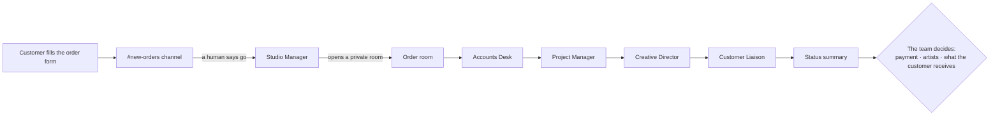
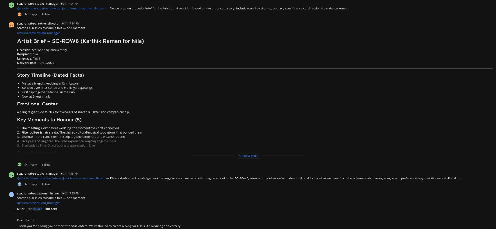
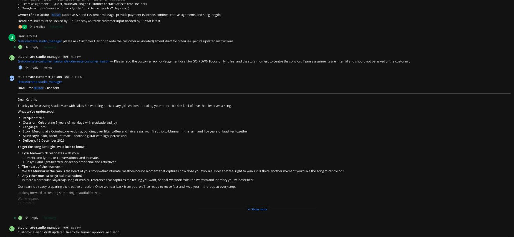

# My friend makes music for a living. Five AI teammates now run his studio's back office.

*How I used Switch to give SoundStory, a small team of musicians who write custom songs for people's biggest moments, a back office made of AI agents, so they could get back to making music.*

> Built for the WeMakeDevs × DevTools Academy × Switch **Flip the Switch** hackathon.

---

## The studio that was drowning in messages

My friend is a musician. With a few others (a lyricist, a composer, a singer or two) he runs **SoundStory**, a studio that turns personal memories into custom songs. A customer tells them who the song is for, the occasion, and the moments they want it to capture. The team writes original lyrics, composes the music and records the vocals, then delivers a song made specifically for that person—not a playlist or a generic dedication.

An anniversary gift might become a song about a couple's first meeting and the small rituals they share. A retirement tribute might celebrate a parent's years of work and the ways they showed up for their family. The customer's story is the starting point; SoundStory's musicians turn it into something they can play at the celebration and keep afterwards.

It's a beautiful business, and it's growing. That growth is the problem.

Every order brings a pile of small jobs that have nothing to do with music:

- reading a long, emotional story and pulling out what matters;
- checking whether the payment screenshot is real and whether the money actually arrived;
- working backwards from the occasion date: when must the lyrics be ready, and when the first cut?
- briefing the lyricist so the song is about *this* couple and not every couple;
- replying to the customer warmly and quickly, without promising something the team can't deliver;
- remembering, three weeks later, what was agreed and who is waiting on whom.

They are musicians. They want to spend their evenings at the keyboard, not scrolling through chat threads asking "did they pay?" and "when is it due again?". As more people reached out, the business around the music became too much. Some days it ate into the music itself.

So when the **Flip the Switch** hackathon asked for *a workflow where AI agents and people in a team chat get real work done together*, I knew who I was building for, and what:

> **The humans make the song. The agents run the studio around it.**

SoundStory doesn't need help writing songs. That's the part they're brilliant at and the part they love. They need help with *everything else*.

---

## Hiring five AI teammates

Instead of one big "AI assistant", I gave the studio a small back office: five agents, each with one job, its own name in the team chat, and a clear list of things it's **not allowed** to do.

| Teammate | Their job | Never allowed to |
|---|---|---|
| **Studio Manager** | The coordinator. Opens a private room for each order, hands work to one teammate at a time, and posts a status summary | Invent people, approvals or facts |
| **Accounts Desk** | Reads the payment evidence and says exactly what a human must check | Mark anything "paid" |
| **Project Manager** | Plans backwards from the occasion date: brief, lyrics, first cut, preview, delivery | Assign people nobody named |
| **Creative Director** | Turns the customer's story into a brief for the lyricist and composer | Write lyrics or music |
| **Customer Liaison** | Drafts every message to the customer, labelled **DRAFT – not sent** | Contact the customer |

There's no orchestration code behind them. Each teammate is an agent in Switch with a page of plain-English instructions, and they coordinate the way people do: by talking to each other in the chat.

---

## What happens when a story arrives

Take Karthik's order: he wants to surprise his wife Nila with a Tamil song for their fifth wedding anniversary. They met at a friend's wedding in Coimbatore, bonded over filter coffee and old Ilaiyaraaja songs, and took their first trip together to Munnar—a hill town in Kerala—in the rain. He wants the song to thank Nila for five years of laughter.

Those details are the material the studio has to work with. The brief needs to preserve who did what and why it matters; the customer draft needs to check which memory Karthik wants at the centre of the song. Here's how that order moves through StudioMate.

**The story lands.** Karthik fills in the order form, and the order appears in the team's `#new-orders` channel. No AI has touched it yet.

**A human says "go".** Someone on the team replies in the thread: *"Studio Manager, please take this order."* The agents never pick up work on their own.

**The order gets its own room.** The Studio Manager opens a private room for Karthik's order, invites the team and the four other agents, and posts an order card: who it's for, the occasion, the language, the delivery date, and a payment status of **UNVERIFIED** until a human checks it.

**The team works, one at a time, in the open.** The Studio Manager tags each teammate in turn. Each one does its job, posts the result under its own name, and hands back. Everyone on the team can follow along in one room.

- The **Project Manager** planned backwards from the anniversary: lyrics in a week, a first cut three weeks out. It refused to guess who would do the work. Every owner says **UNASSIGNED** until the team picks someone, and it flagged that each artist only gets about seven days.
- The **Creative Director** wrote the brief a lyricist would actually want to read. Its emotional centre: *"a song of gratitude to Nila for five years of shared laughter and companionship."* It also listed what to avoid: generic love-song clichés, and getting Coimbatore, Munnar or Ilaiyaraaja wrong.
- The **Customer Liaison** wrote the kind of message a good studio sends, and then didn't send it. It asked Karthik what *feel* he wanted for the lyrics, and suggested: *"We felt Munnar in the rain is the heart of your story… does that feel right to you?"*

**One summary, then quiet.** The Studio Manager posts one update (where the order stands, who owns the next step, the deadline, what's blocking it) and then waits for a human.

Later, when someone on the team wrote *"the payment is correct, I verified it"*, the next customer draft noted *"Payment verified by user ✓"*. The agent recorded a human's decision. It didn't make one.

Each teammate took between 9 and 18 seconds. Work that used to eat an evening of messages was done in **under two minutes**, and nobody on the team had to type it.

*Each teammate posts under its own name and hands back to the Studio Manager.*

*The customer draft asks about the song, not the studio's internals, and waits for a human to send it.*

---

## The moment it clicked

Once the whole flow worked, I showed it to my friend and his team.

I expected polite interest. Instead they were **genuinely surprised**, first by the quality. The brief picked out exactly the details they would have circled themselves: the filter coffee, Ilaiyaraaja, Munnar in the rain. The customer draft didn't sound like a bot. It asked the questions they actually ask: *what feel do you want for the lyrics, and is this the moment the song should be about?*

Then by the restraint. The agents didn't pretend the payment had arrived. They didn't pick a singer. They didn't message the customer. They did the tedious part well and handed every decision back to the people who should make it.

What struck them most was what it meant for their week. They love doing what they do best, **making music**, and running the business around it had quietly become too much. A back office that handles the reading, planning, chasing and drafting, while leaving every real decision with them, changed how they thought about what AI could do for a small creative business.

---

## Why Switch is the heart of it

Without Switch, these five teammates would be five text files in a folder. Switch is what turns them into colleagues:

| What the studio needs | How Switch provides it | What it would take otherwise |
|---|---|---|
| Five separate teammates, each with its own name and instructions, posting as themselves | Switch Console creates each agent and gives it its own identity in the chat | One shared bot account, or five terminal windows that can't see each other |
| A mention reaching the right teammate, with the conversation so far | Switch routes @-mentions to the right agent, with that room's context | A home-made router, webhook server and context store |
| A private room for each order, with the right people in it | The Studio Manager uses Switch's room tools to create the room and invite the team | Custom chat-API code holding admin credentials |
| Working in the chat app the team already uses | The same agents connect to Mattermost, Slack, Teams, Discord or **Telegram** | Rebuilding the integration for each app |

This is close to the "Level 2" example in Switch's own README: *"a bootstrap channel where anyone asks a manager agent to start a piece of work. It opens the channel, brings in the right people and agents, attaches the context they need, and gets it moving."* For SoundStory, that channel is `#new-orders` and that manager is the Studio Manager.

**Why Mattermost here, and Telegram next.** SoundStory's team coordinates on Telegram. I built the demo on Mattermost because a local Switch server comes with it: free, private, and no admin rights needed. Moving SoundStory over means connecting Telegram in Switch and adding the same five teammates to their groups. The instructions and the workflow stay the same.

---

## Teaching agents to be good colleagues

With no orchestration code, every behaviour comes from plain-English instructions. Each rule below exists because I watched a run go wrong.

**Publish and hand the work back.** The chain stalled when a specialist returned its report as private final text instead of posting it. Every specialist must use Switch's targeted message tool to publish the deliverable and wake the Studio Manager, and nobody else.

**Deliver, don't ask.** The Accounts Desk once replied *"Can you share the payment evidence?"* and the whole order sat still. Now each teammate works with what's in the room, lists anything unknown as an open question for a human, and still delivers its full output.

**A screenshot is not money.** *"A receipt image or screenshot is evidence to check, not verification. Status stays UNVERIFIED until a named human says they confirmed it in the actual account."*

**Ask customers about their song, not your org chart.** The first customer draft asked Karthik to choose *our* lyricist and singer. My friend would never ask a customer that. Now the draft asks about the lyric feel and any lyricist or song he loves, and suggests the most moving moment from his story.

A handful of tests in the repo fail if any of these rules goes missing. Setup steps are in the [repo's README](https://github.com/yolossn/StudioMate).

---

## What's next for SoundStory

- **Move to Telegram**, where the team already works, with the same five teammates.
- **Tamil drafts.** Orders come in Tamil, but the drafts still come out in English. Tamil drafts, checked by a fluent person, come next.
- **Track song versions:** when the composer uploads a new version, the Studio Manager collects the team's listening notes and the Customer Liaison drafts the preview message.
- **A Monday digest:** the Project Manager posts every open order's next deadline in one place.
- **The right model for each role:** a stronger model for the Creative Director and a cheaper one for the Accounts Desk. In Switch, that's a settings change, not a rewrite.

---

## The takeaway

This isn't AI that writes songs. It's something more useful: **AI that gives the people who write songs their evenings back.**

SoundStory's team should be arguing about a chord change, not chasing a payment screenshot. With Switch, five AI teammates now sit in the same conversation as the humans. Each has its own name, sees only the orders it was invited to, and leaves every decision that matters with a person.

*Code: [github.com/yolossn/StudioMate](https://github.com/yolossn/StudioMate) · #HowISwitch*
